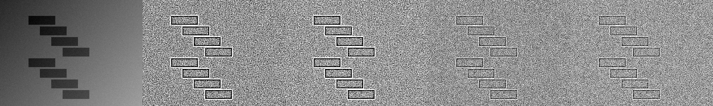
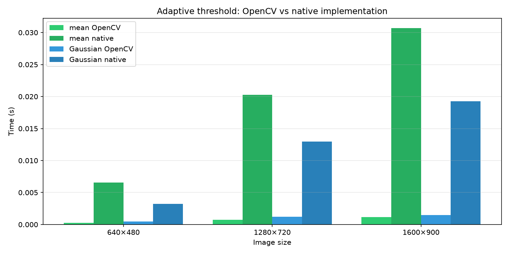

Реализация адаптивной бинаризации в двух вариантах: OpenCV и нативно на Python (NumPy), сравнение быстродействия.

## 1. Теоретическая база

**Бинаризация** переводит полутоновое изображение в два уровня (обычно 0 и 255). При **глобальном** пороге одно значение $T$ для всего кадра плохо работает при неравномерной освещённости.

**Адаптивный порог** задаёт локальный порог для каждого пикселя $(x, y)$ по окрестности размером `blockSize × blockSize`:

$$
T(x,y) = \mathrm{stat}(W_{x,y}) - C
$$

где $\mathrm{stat}$ — статистика окна, $C$ — константа (обычно 2–10).

| Метод | stat($W$) |
|--------|-----------|
| **Mean (ADAPTIVE\_THRESH\_MEAN\_C)** | среднее арифметическое яркостей в окне |
| **Gaussian (ADAPTIVE\_THRESH\_GAUSSIAN\_C)** | взвешенное среднее с весами по двумерной Gaussian |

Пиксель бинаризуется так (тип `THRESH_BINARY`):

$$
\mathrm{out}(x,y) = \begin{cases} \mathrm{maxValue}, & I(x,y) > T(x,y) \\ 0, & \text{иначе} \end{cases}
$$

`blockSize` — нечётное число $\geq 3$. Для mean-варианта локальную сумму можно ускорить **интегральным изображением** (summed-area table) за $O(1)$ на пиксель; Gaussian часто считают **разделимой свёрткой** (два прохода 1D).

## 2. Описание разработанной системы

### Архитектура проекта

```
SKOI/
├── src/
│   ├── opencv_impl.py   # cv2.adaptiveThreshold (MEAN / GAUSSIAN)
│   ├── native.py        # mean через интегральное изображение; Gaussian — separable conv
│   └── io_utils.py      # загрузка / синтетический тестовый кадр
├── demo.py              # визуальное сравнение реализаций
├── benchmark.py         # замеры времени, график
├── assets/sample.png    # тестовое изображение
└── output/              # результаты (PNG, JSON, график)
```

### Алгоритмы

1. **OpenCV** — вызов `cv2.adaptiveThreshold` с `ADAPTIVE_THRESH_MEAN_C` или `ADAPTIVE_THRESH_GAUSSIAN_C`, `THRESH_BINARY`.
2. **Native mean** — отражающий padding, интегральное изображение, локальное среднее, вычитание $C$, порог.
3. **Native Gaussian** — ядро Gaussian ($\sigma$ как в OpenCV), разделимая 1D-свёртка с reflect padding, затем тот же порог.

Параметры по умолчанию: `block_size=11`, `C=2`, `max_value=255`.

### Запуск программы

```bash
python3 -m venv .venv && source .venv/bin/activate
pip install -r requirements.txt
python demo.py
python benchmark.py
```

## 3. Результаты работы и тестирования

### Визуальное сравнение

Исходный кадр и бинаризация (слева направо: gray → mean OpenCV → mean native → Gaussian OpenCV → Gaussian native):



**Согласованность с OpenCV:** средняя абсолютная ошибка между парами реализаций на тестовом кадре — около **6** уровней из 255 (различия на границах объектов из‑за отличий обработки краёв и дискретизации ядра).

### Быстродействие

Замеры: медиана 5 прогонов после 2 прогревов, синтетические изображения тех же размеров.



| Размер | mean OpenCV | mean native | Gaussian OpenCV | Gaussian native |
|--------|-------------|-------------|-----------------|-----------------|
| 640×480 | 0,26 ms | 6,5 ms | 0,45 ms | 3,2 ms |
| 1280×720 | 0,71 ms | 20,3 ms | 1,23 ms | 13,0 ms |
| 1600×900 | 1,12 ms | 30,7 ms | 1,51 ms | 19,3 ms |

**Закономерности:**

- OpenCV быстрее на **порядок и более** (оптимизированный C/C++, SIMD).
- Время растёт примерно **линейно** с числом пикселей.
- На малых разрешениях native Gaussian может быть быстрее native mean из‑за стоимости построения SAT vs. separable conv; на больших кадрах обе native-версии существенно медленнее OpenCV.

Полные численные данные сохранены в файле `output/benchmark.json`.

## 4. Выводы

1. Адаптивная бинаризация устойчивее глобального порога при градиенте освещения.
2. Методы **mean** и **Gaussian** дают близкий вид результата; Gaussian чуть сглаживает локальную статистику.
3. Библиотечная реализация (OpenCV) предпочтительна для практики по скорости; нативная полезна для понимания алгоритма и учебной проверки.
4. Визуальные и численные результаты воспроизводятся скриптами `demo.py` и `benchmark.py`.

## 5. Использованные источники

1. OpenCV Documentation — Adaptive Threshold: https://docs.opencv.org/4.x/d7/d1b/group__imgproc__misc.html
2. Bradski G., Kaehler A. Learning OpenCV 3 / OpenCV 4 — раздел пороговой обработки.
3. Gonzalez R., Woods R. Digital Image Processing — локальная пороговая обработка.
4. NumPy Documentation — https://numpy.org/doc/
5. Python Documentation — https://docs.python.org/3/
